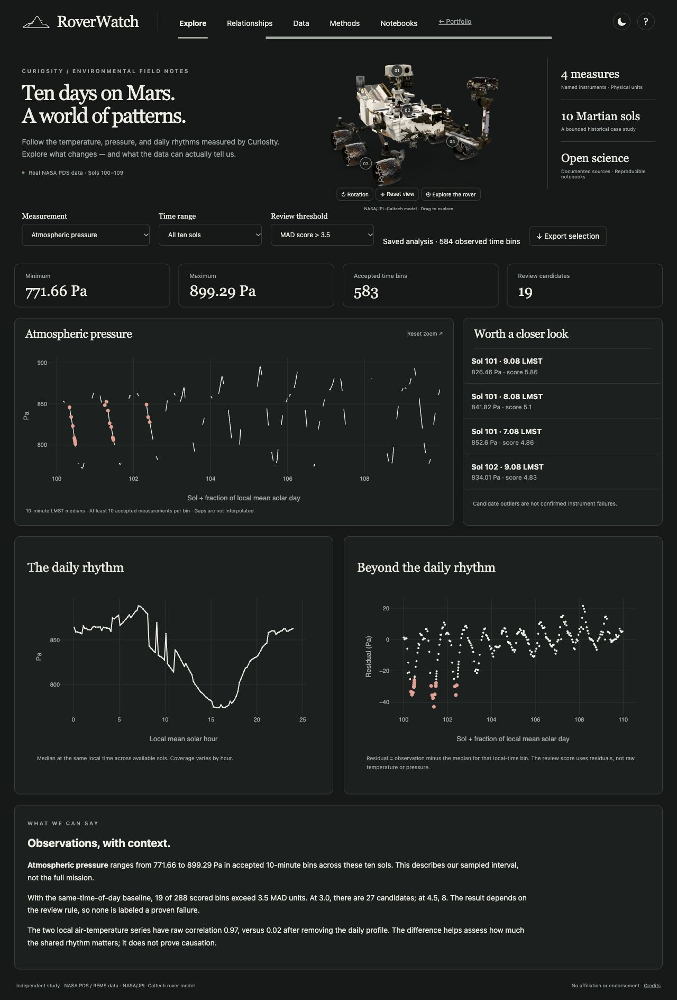

# RoverWatch — Mars Environmental Explorer

**What changes in Curiosity’s environmental measurements, and which departures deserve a closer look?**

[Explore the live study](https://deamoncash.github.io/rover-watch-demo/)

A reproducible study of **306,257 original NASA PDS REMS records across sols 100–109**, with four named measurements: local air temperature at two booms, atmospheric pressure, and ground brightness temperature. It combines Python analysis, three executed notebooks, and an interactive website with the official NASA/JPL-Caltech Curiosity model.



## What the project does

- Audits missing values, duplicate timestamps, and instrument-specific confidence flags.
- Aggregates accepted observations into hourly or ten-minute local-mean-solar-time bins without filling gaps. Explore defaults to hourly and also offers individual quality-filtered measurements, one sol at a time; each view recomputes its own scores from source observations. The notebooks, Data sample and Relationships PCA retain the original ten-minute study.
- Describes daily cycles and reviews departures using a robust median/MAD score.
- Compares raw and daily-profile-adjusted relationships; explores standardized PCA on 579 complete bins.
- Shows actual saved notebook outputs, downloadable data, source provenance, parameter choices, and limitations.
- Offers light/dark themes, automatic chart updates, filters, export, and an educational 3D rover.

## Scientific scope

This is retrospective exploratory analysis, not forecasting, fault diagnosis, or rover navigation reconstruction. A review candidate is not a confirmed sensor fault. The 3D model is educational and is not animated from these measurements.

All accepted observations contribute to the descriptive baselines. No train/test split is needed for that purpose; this design does not establish detection performance on unseen data. Isolation Forest is not part of the current study. Earlier anonymous telemetry experiments remain in private project history.

The review score is `abs(r - median(r)) / (1.4826 * median(abs(r - median(r))))`, where `r` is the departure from the same-local-time median. At least five contributing sols are required. The 1.4826 factor rescales MAD; it does **not** set a 99% threshold. The default cutoff 3.0 is a review heuristic, with alternatives at 3.5 and 4.5. Zero MAD yields no score. No fixed anomaly proportion is imposed.

The ten-sol interval and uneven coverage limit generalization. Raw and residual correlation matrices have different eligible samples. Temporal dependence prevents naive independent-observation significance claims. PCA summarizes association, not causality or sensor identity. Quality-filtered data are not guaranteed error-free.

## Reproduce the analysis

Python 3.12 and curl are required. Packages used for the saved results are pinned in `requirements-rems.txt`.

```sh
python3 -m venv .venv
source .venv/bin/activate
pip install -r requirements-rems.txt
python rems_pipeline.py
python rems_analysis.py
python build_rems_notebooks.py
python -m pytest tests/test_rems.py -q
```

The downloader retrieves the original tables, labels, format, and errata from NASA PDS, validates record sizes, and retains SHA-256 provenance. Raw downloads and the parsed cache go to `data/rems/`. Rebuilt exports go to `web/data/`; executed notebooks go to `web/notebooks/`.

In the source checkout, serve the UI with `python -m http.server 8592 --directory web`. In the public demo checkout, the published static UI is at the root: use `python -m http.server 8592`; regenerated exports in `web/` can be compared with the shipped `data/` and `notebooks/` outputs.

The website reads saved outputs immediately; it does not pretend to execute Python. Downloaded notebooks can be rerun inside a checkout containing the scripts after downloading the data. Computation uses the local CPU, not a GPU. The result manifest records the hardware and package versions.

## Data provenance and credits

- [NASA PDS dataset](https://pds.nasa.gov/ds-view/pds/viewProfile.jsp?dsid=MSL-M-REMS-5-MODRDR-V1.0)
- [REMS archive, format, and errata](https://atmos.nmsu.edu/PDS/data/mslrem_1001/)
- [PDS data usage](https://pds-geosciences.wustl.edu/faq.html)
- Instrument team: Centro de Astrobiología / J. Gómez-Elvira and collaborators.
- Rover model: NASA/JPL-Caltech. Model-viewer: Apache 2.0. Plotly: MIT. See the bundled asset credits and licenses.

Independent project by Mehdi, developed with AI assistance. No NASA/JPL affiliation or endorsement. Personal planning notes are excluded from publication.

Individual observations come from NASA-processed REMS products, not uncalibrated sensor voltages. Each is scored against the hourly profile and the hourly residual MAD from the ten-sol study. Closely spaced measurements are dependent, and this exploratory rule can flag many samples from one sustained period; those counts are not independent events or verified faults. Rebuild these exports with `python make_raw_views.py`.

The optional trend is a robust LOWESS-style local linear regression: a 2-hour radius, tricube distance weights, up to two bisquare residual reweightings, at least two locally weighted points, and a break at gaps greater than 2 hours. Individual observations are first summarized as 5-minute medians to avoid overweighting measurement bursts. The outlier visibility filter excludes flagged points from the input when enabled. Fitted values are exploratory estimates, not additional measurements; bandwidth and gap threshold are explicit choices, not validated optimum settings.
